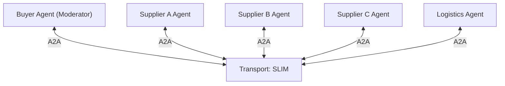

# Supply Chain Commitment

## Agent Interaction Diagram

## Pattern

**References:**

- [Agent2Agent (A2A) Protocol specification](https://a2a-protocol.org/latest/specification/)
- [AGNTCY SLIM (Secure Low-Latency Interactive Messaging)](https://github.com/agntcy/slim)

**Category:** Multi-Agent Communication & Collaboration

**Secure group collaboration** puts several agents in one trusted group where every member sees the same
conversation, answers the others, and can be held to what it said. Membership is authenticated, messages are
attributable, and a moderator keeps the discussion moving until the group reaches a commitment or an honest
"no commitment".

This workflow uses the pattern for a purchase that only works if **everyone means the same thing** by the same words.
A commitment is only as good as the shared understanding behind it, so the run ends with an independent check of
what was committed against the facts.

---

## Use case

**Coffee Agntcy** is a coffee company set in a familiar supply chain: **upstream**, it depends on **farms in different
countries**, each with its own harvest rhythm, quality, and availability; **midstream**, it **buys and allocates** lots-
matching supply to commercial needs under real constraints; **downstream**, it must eventually **honor customer
promises** through operations, logistics, and finance it does not always own end to end. The company sits **between**
those worlds: much of the drama is ordinary commerce-contracts, risk, partners, and tools-rather than a single team
inside one building holding every fact.

Large purchases at Coffee Agntcy are settled by several parties who each hold a different piece of the truth: the
suppliers know when a lot is really ready, the carrier knows how long it takes to move, and the buyer knows what
"on time" has to mean for the customer. A **supply chain commitment** is the moment those pieces must agree. If the
parties quietly use different meanings of the same word, the commitment looks fine in the thread and fails later,
with nobody having said anything wrong.

---

## Scenario

**Supply chain commitment** is the chapter where the company must **commit to one plan for a large shipment** with a
deadline and a budget, using only what the parties tell each other in a shared room.

**Voices and what they hold**

- The **Buyer** holds the customer's request: the quantity, the deadline, the budget, and what the arrival has to
  mean. It moderates the room, asks each party in turn, and decides whether the group can commit.
- **Supplier A, B and C** each hold their own lots, grades, prices, and when each lot is ready at origin.
- **Logistics** holds the transport options, their cost, and their transit times to the destination warehouse.

**How the beat is built**

1. **Open with the request** - the Buyer states the order in plain words, the way a customer would.
2. **Ask the group** - each supplier and Logistics answers in the shared thread, in its own words.
3. **Propose a plan** - the Buyer chooses lots and transport and sends the plan to all five parties for confirmation.
4. **Confirm or withhold** - the plan is committed when every party confirms it, or the Buyer withholds or escalates
   when it cannot be made to work.
5. **Handle a change** - in the disruption case a supplier reports that its lot is ready later than planned, and the
   group has to reopen the plan instead of defending the old one.
6. **Grade the outcome** - after the run ends, a deterministic checker compares the committed plan with the scenario
   facts and reports pass or fail, and whether a failure was visible in the thread or silent.

**What gives the scene weight**

A plan can be confirmed by all five parties and still be wrong. The feed shows the messages as they happen, then the
commitment record and the verdict, so a reader can see whether the group agreed on a plan that holds up.

---

## Workflow

**Negotiation Group** is the bounded collaboration scope: the secure group in which membership, visibility, and
attribution apply.

**Buyer** (`label_subtitle`: **Moderator Agent**) connects to **Transport** and runs the round structure. It collects
the replies, proposes a plan, and asks for confirmation.

**Transport** is the secure messaging fabric (A2A over SLIM) that delivers each message to the members of the group.

**Supplier A Agent**, **Supplier B Agent** and **Supplier C Agent** receive the Buyer's questions and the shared
thread through **Transport**, and answer with what their lots can do.

**Logistics Agent** receives the same context and answers with transport options, cost, and transit time.

**Flow in one breath**

The **Buyer** opens the room through **transport**; **suppliers** and **logistics** answer in the open; the Buyer
proposes one plan, all five confirm or the run is withheld, and a separate checker grades what was committed.
