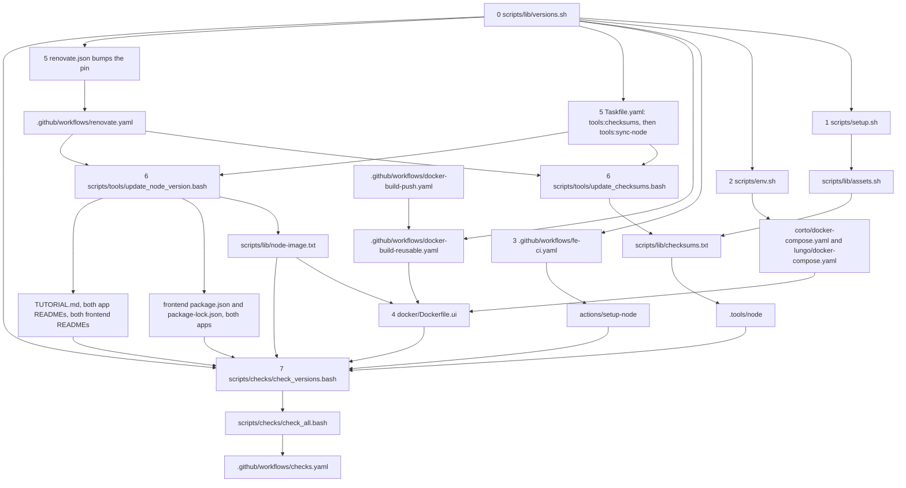

# Node version

`NODE_VERSION` in `scripts/lib/versions.sh` is the only pin. Edit that file, then let the steps below copy it. Do not write the version anywhere else. The map of every pin is [tool-versions.md](tool-versions.md).

## 0. Pin

`scripts/lib/versions.sh` sets `NODE_VERSION`. The `# renovate: datasource=node-version` comment above it is what Renovate matches.

## 1. Install the toolchain

`scripts/setup.sh` sources `scripts/lib/versions.sh`.

`scripts/lib/assets.sh` turns `NODE_VERSION` into the nodejs.org tarball URL. `scripts/lib/checksums.txt` must already contain that URL's SHA-256. `scripts/setup.sh` refuses the download otherwise, then unpacks it into `.tools/node`.

## 2. Export it for local builds

`scripts/env.sh` sources `scripts/lib/versions.sh` and exports `NODE_VERSION` and `UV_VERSION`. It puts `.tools/node/bin` on `PATH`. Local UI builds start here: `source scripts/env.sh`. The uv image path is in [tool-versions.md](tool-versions.md).

## 3. Frontend CI

`.github/workflows/fe-ci.yaml` sources `scripts/lib/versions.sh` and passes the value to `actions/setup-node`.

## 4. UI image

These callers pass the same variable in. `docker/Dockerfile.ui` takes `ARG NODE_VERSION` with no default and uses it in `FROM node:${NODE_VERSION}-alpine@<digest>`. A build with the arg unset fails.

- Local: `coffeeAGNTCY/coffee_agents/corto/docker-compose.yaml` and `coffeeAGNTCY/coffee_agents/lungo/docker-compose.yaml` pass `${NODE_VERSION}` from the environment set in step 2.
- CI: `.github/workflows/docker-build-push.yaml` calls `.github/workflows/docker-build-reusable.yaml`, which sources `scripts/lib/versions.sh` and adds the build-arg only when the dockerfile is `docker/Dockerfile.ui`.

The `@sha256:` on that `FROM` line is not the variable. Step 6 writes it.

## 5. Bump

Change `NODE_VERSION` only in `scripts/lib/versions.sh`.

By hand, run `task tools:checksums` and then `task tools:sync-node` (`Taskfile.yaml`).

Renovate does the same on a branch. `renovate.json` (`customManagers`) bumps the pin. Its toolchain `postUpgradeTasks` runs `scripts/tools/update_checksums.bash` and `scripts/tools/update_node_version.bash`. `.github/workflows/renovate.yaml` allowlists those commands. The same `renovate.json` disables the dockerfile manager for `docker/Dockerfile.ui`, so Renovate does not replace `${NODE_VERSION}` with a number.

## 6. Rewrite the copies that cannot source the pin

`scripts/tools/update_checksums.bash` (`task tools:checksums`) refreshes `scripts/lib/checksums.txt`, which step 1 requires for the new tarball.

`scripts/tools/update_node_version.bash` (`task tools:sync-node`) reads `NODE_VERSION`. If `scripts/lib/node-image.txt` is missing or names another version, it fetches the `node:<version>-alpine` manifest-list digest. It then writes:

- `scripts/lib/node-image.txt` (version and digest)
- the `@sha256:` in `docker/Dockerfile.ui`
- the root `engines.node` floor (`>=` plus the pin) in `coffeeAGNTCY/coffee_agents/corto/exchange/frontend/package.json`, `coffeeAGNTCY/coffee_agents/corto/exchange/frontend/package-lock.json`, `coffeeAGNTCY/coffee_agents/lungo/frontend/package.json`, and `coffeeAGNTCY/coffee_agents/lungo/frontend/package-lock.json`
- the Node.js sentence in `TUTORIAL.md`, `coffeeAGNTCY/coffee_agents/corto/README.md`, `coffeeAGNTCY/coffee_agents/lungo/README.md`, `coffeeAGNTCY/coffee_agents/corto/exchange/frontend/README.md`, and `coffeeAGNTCY/coffee_agents/lungo/frontend/README.md`

If `scripts/lib/node-image.txt` already records this `NODE_VERSION` and those files already agree, the script exits without contacting the registry.

## 7. Check

`scripts/checks/check_versions.bash` (`task versions:check` in `Taskfile.yaml`) reads `scripts/lib/versions.sh` and fails when any install in steps 1 to 4 uses a literal, or when `scripts/lib/node-image.txt`, the digest, the engine floors, or the doc sentences disagree with `NODE_VERSION`. The same script also checks the other pins in `versions.sh`.

`scripts/checks/check_all.bash` runs that check. `.github/workflows/checks.yaml` runs `task check:all`.
