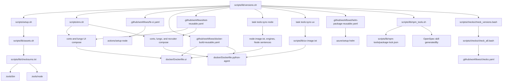

# Tool versions

`scripts/lib/versions.sh` is the only pin for every tool below. This map is where each pin goes. The numbered Node procedure, including every engine file and README sentence, is [node-version.md](node-version.md).

## Download

`scripts/setup.sh` sources `scripts/lib/versions.sh`. `scripts/lib/assets.sh` turns the pin into a download URL. `scripts/lib/checksums.txt` must already hold that URL's SHA-256, or `setup.sh` refuses the download.

These pins stop at `.tools/bin`: actionlint, bats, shellcheck, shfmt, and task. Helm, the uv CLI, and the Node tarball use the same download. Helm's CI reader and the uv image are below. The Node tarball unpacks into `.tools/node`, and its image path is [node-version.md](node-version.md).

`task tools:checksums` rewrites `scripts/lib/checksums.txt` after a pin bump. Renovate runs that script from the toolchain `postUpgradeTasks` in `renovate.json`. `.github/workflows/renovate.yaml` allowlists the command.

## Node image

`scripts/env.sh` exports `NODE_VERSION`. The corto and lungo UI services pass it into `docker/Dockerfile.ui`. `.github/workflows/fe-ci.yaml` passes it to `actions/setup-node`. `.github/workflows/docker-build-reusable.yaml` passes it only when the dockerfile is `docker/Dockerfile.ui`. `.github/workflows/test-reusable.yaml` exports it before pytest so the UI compose files interpolate during the integration tests. `task tools:sync-node` writes `scripts/lib/node-image.txt`, the image digest, the `engines.node` floors, and the Node sentences. The file list is [node-version.md](node-version.md).

## uv image

`scripts/env.sh` exports `UV_VERSION` in the same way. These compose files pass it into `docker/Dockerfile.python-agent`:

- `coffeeAGNTCY/coffee_agents/corto/docker-compose.yaml`
- `coffeeAGNTCY/coffee_agents/lungo/docker-compose.yaml`
- `coffeeAGNTCY/coffee_agents/recruiter/docker/docker-compose.yaml`

`.github/workflows/docker-build-reusable.yaml` passes `UV_VERSION` only when the dockerfile is `docker/Dockerfile.python-agent`. `.github/workflows/test-reusable.yaml` exports it before pytest so those compose files interpolate during the integration tests. The `ARG` is declared before the first `FROM` and has no default, so a build without it fails. `python3.13-trixie-slim` stays a literal.

The uv CLI that CI itself runs comes from `astral-sh/setup-uv` in `.github/workflows/test-reusable.yaml`, `.github/workflows/python-lint.yaml`, and `.github/workflows/renovate.yaml`. Each workflow reads `UV_VERSION` from `scripts/lib/versions.sh` in an earlier step, writes it to a step output, and passes `version: ${{ steps.<id>.outputs.UV_VERSION }}`, because editors cannot see a variable set through `GITHUB_ENV`. `test-reusable.yaml` also exports it into the job env, because pytest's `docker compose` interpolates it. The check also accepts `version: ${{ env.UV_VERSION }}`. `task versions:check` fails a `setup-uv` step with no version or a literal one.

Python agent images used uv 0.11.16 before this pin took over the `FROM` line. They now build on `UV_VERSION`, so the uv that runs `uv sync --locked` is a newer 0.x minor. Mention it in the release notes migration block.

`task tools:sync-uv` (`scripts/tools/update_uv_image.bash`) writes `scripts/lib/uv-image.txt` and the `@sha256:` on that `FROM` line. Both are the manifest-list digest of `astral/uv:<UV_VERSION>-python3.13-trixie-slim`. Renovate runs that script on a `versions.sh` bump and leaves the dir-ctl and dir-mcp `FROM` lines in the same Dockerfile managed.

## Helm CI

The Helm binary installed above is `HELM_VERSION`, including its leading `v`, because the get.helm.sh archive name contains it. `.github/workflows/helm-package-reusable.yaml` sources the same pin and passes `${HELM_VERSION#v}` to `azure/setup-helm`. The action prefixes `v` again before it downloads `helm-v<version>-...`.

## npm pins

`OPENSPEC_VERSION` and `RENOVATE_VERSION` do not go through `scripts/lib/assets.sh`. `scripts/lib/npm_tools.sh` writes their `package.json` from the pins. `task tools:npm-lock` rewrites `scripts/lib/npm-tools/package-lock.json`. `scripts/setup.sh` runs `npm ci` from that lockfile.

Each OpenSpec skill `generatedBy` stamp equals `OPENSPEC_VERSION`. Those files are `.agents/skills/openspec-*/SKILL.md`. `task tools:sync-openspec` (`scripts/tools/update_openspec_skills.bash`) regenerates them: it installs the pinned openspec from the committed lockfile into a temp dir (`npm ci --ignore-scripts`) and runs `openspec update`. It does nothing when every stamp already matches. Renovate runs it after `update_npm_lock.bash`, and `.github/workflows/renovate.yaml` allowlists the command.

## Not covered

A tag that moves under the same version number is not caught. A digest in `scripts/lib/node-image.txt` or `scripts/lib/uv-image.txt` stays as written until the version changes, because the check compares versions, not what the registry serves today. A new `NODE_VERSION` or `UV_VERSION` changes the tag, and the sync task then fetches the digest again. Re-fetching a digest for an unchanged tag is out of scope.

## Check

The compose files pass `NODE_VERSION` and `UV_VERSION` as `${VAR:?...}` with no default. When the variable is missing, Compose prints `run: source "$(git rev-parse --show-toplevel)/scripts/env.sh"`, which works from any directory in the repo. `docker/Dockerfile.ui` is the only Node image that must carry the digest in `scripts/lib/node-image.txt`. `scripts/tools/update_node_version.bash` and `scripts/tools/update_uv_image.bash` record a digest only when the registry answers with a manifest list or an OCI index. `.github/workflows/helm-push.yaml` and `.github/workflows/docker-build-push.yaml` list `scripts/lib/versions.sh` in their pull request path filters, so a pin bump runs them. The rule in [.agents/rules/quality/version-sync.md](../.agents/rules/quality/version-sync.md) lists how the check reads each file.

`scripts/checks/check_versions.bash` (`task versions:check`) reads `scripts/lib/versions.sh` and fails when any pin above has a second copy: a literal install, a digest, an `engines.node` floor, a lockfile version, a `generatedBy` stamp, or a Node sentence that disagrees. `scripts/checks/check_all.bash` runs it. `.github/workflows/checks.yaml` runs `task check:all`.
